# Ph-UI!!!

---

## Lab Overview
Members: Yuqi Wang (yw2897)
Project name: Dinner Dial — What Should We Eat?

For lab this week, we focus on both sensing and actuation, bringing new modes of input and output into your devices, while also prototyping the physical structure and overall look of the device. You will consider how the physical form supports sensing and actuation, and how these elements come together to shape the interaction and aesthetics of the device.

---

## Lab Structure

A) [Capacitive Sensing](#part-a)

B) [More Sensors](#part-b)

C) [Servo Actuation](#part-c)

D) [Physical Interaction Design: Feast Automata](#part-d)

E) [Build & Integrate](#part-e)

F) [Final Documentation](#part-f)

---

## Part 1 Lab Preparation
### Part A
### Part B
### Part C
### Part D
Dinner Dial — What Should We Eat?

Dinner Dial turns the everyday question “What should we eat?” into a playful physical interaction. The design uses a joystick to select between Rice, Noodles, and Dumplings, with a servo-driven paper pointer indicating the choice. Built from A4 paper, tape, and electronic components, this early prototype explores the menu layout, joystick placement, and space needed for the moving pointer. It brings a simple, hands-on moment of play to the dining table.
**\*\*\*Draw 5 sketches that explore different physical arrangements for your sensing and actuation.\*\*\***
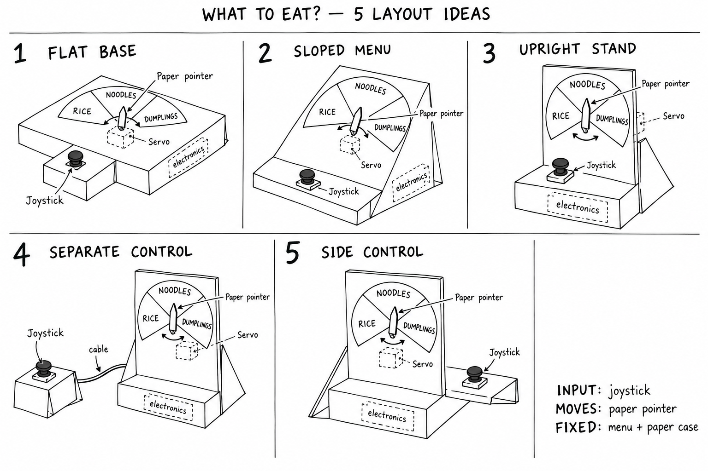

**\*\*\*What questions do these sketches raise? What do you need to physically prototype to answer them?\*\*\***
These sketches raise several questions: Which menu angle is easiest to read while sitting at a table? Is the joystick more comfortable in front, on the side, or separate from the menu? Will the paper structure stay stable when someone uses the joystick? Can the pointer move without touching the menu? Is there enough space for the electronics and wires?

I need to make simple folded-paper mockups to compare viewing angles and joystick positions. Then, I will prototype the flat-base design with the actual joystick, servo, and a short paper pointer. This will let me test the mounting, pointer clearance, and whether the pointer clearly indicates each food option. I will also check whether using the joystick makes the base slide or bend.

**\*\*\*Pick one design to prototype and explain why.\*\*\***
I chose the first design, the flat-base layout, because it is simple to build with folded paper and tape. The menu stays fixed on top, while the servo underneath rotates a short paper pointer. The joystick sits at the front where it is easy to reach. The low, wide base should help the structure stay stable and provide space for the electronics. This design lets me focus on testing the interaction: moving the joystick to select a food option.

**\*\*\*Document your rough prototype with photos and/or video.\*\*\***
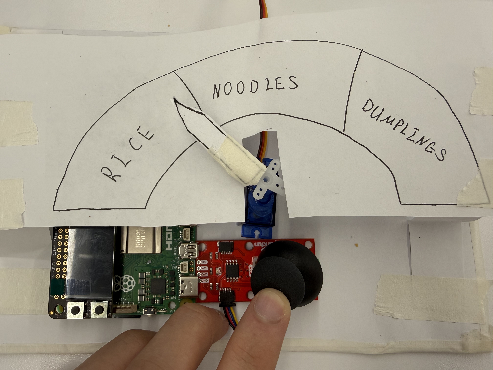
Left — Rice: The pointer is positioned over the Rice section on the left side of the menu. This shows the intended selection state when the user moves the joystick left. The menu stays fixed while the pointer changes position.

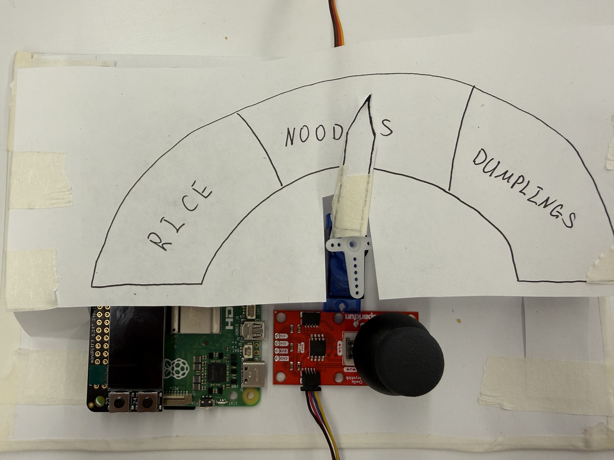
Center — Noodles: The pointer points toward Noodles in the middle of the menu. This view shows the relationship between the joystick, the pointer, and the three food options. The large handwritten labels make the choices easy to identify.

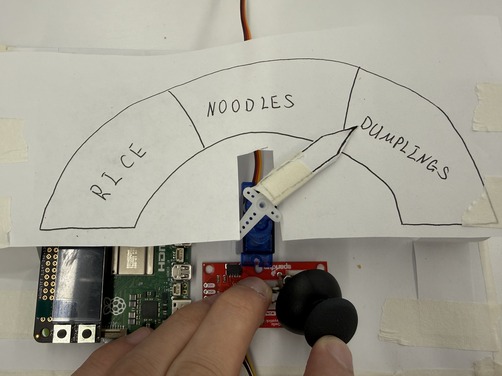
Right — Dumplings: The pointer is positioned over the Dumplings section on the right. This represents the intended response to moving the joystick right. Together, the three views illustrate how the physical pointer could communicate the user’s food selection.

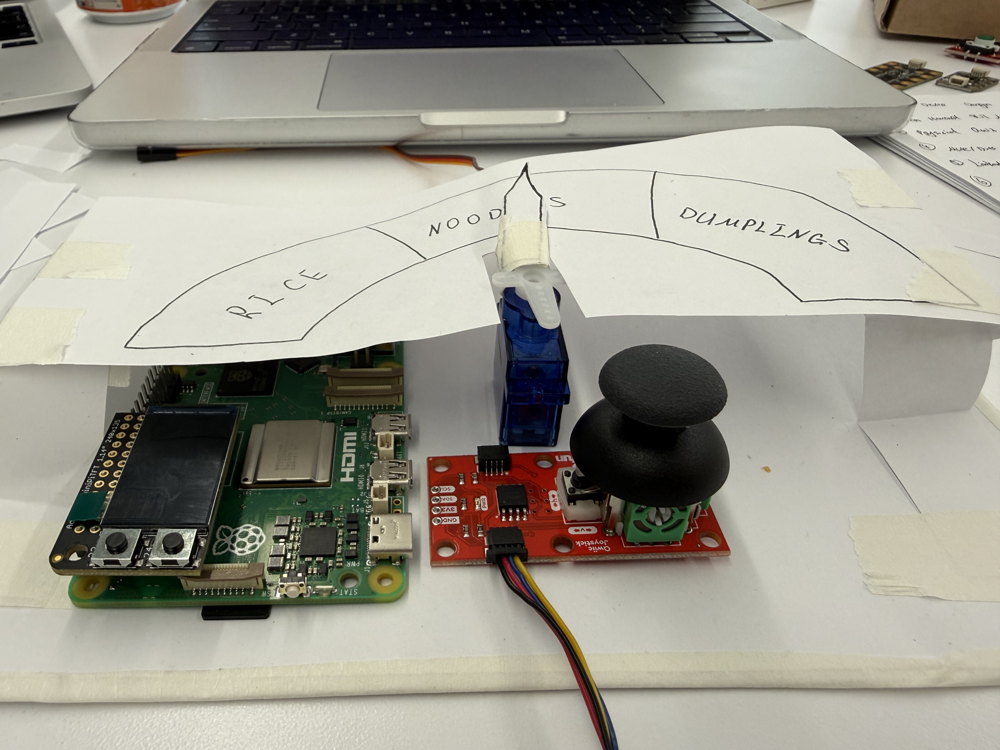
Side View — Physical Structure: Folded-paper supports raise the menu above the base, leaving space for the electronics underneath. The servo sits in the central opening, with the paper pointer attached to its plastic horn. The joystick is accessible at the front, while the Raspberry Pi and display sit to the left.
---

## Part 2
Following exploration and reflection from Part 1, complete the "looks like," "works like" and "acts like" prototypes for your design, reiterated below.
### Part E

### Build & Integrate: Dinner Dial

Dinner Dial turns the question “What should we eat?” into a physical interaction. A joystick lets the user choose between Rice, Noodles, and Dumplings. A servo moves a paper pointer to the selected food, while a USB speaker announces the choice in English.

The prototype uses a Raspberry Pi 5, a SparkFun Qwiic Joystick, a SparkFun Pi Servo pHAT, a micro servo, and a USB speaker. The printed menu is attached to a 20 × 13 cm cardboard box lid. The servo sits inside the box, with the pointer above the lid.

#### 1. Code

- [Main program: dinner_dial.py](./dinner_dial.py) — reads the joystick, stores the selected food, moves the servo, and plays the matching announcement.
- [Launch script: run_dinner_dial.sh](./run_dinner_dial.sh) — starts the program with the settings used for this assembled prototype.
- [Calibration helper: calibrate_menu.py](./calibrate_menu.py)
- [Basic servo test: servo_small_test.py](./servo_small_test.py)
- [English audio files](./audio/) — rice.wav, noodles.wav, and dumplings.wav.

#### 2. Working Prototype in Action

The program starts at Noodles. Each left or right tilt moves the selection by one position and automatically plays the corresponding announcement. No button press is needed.

Releasing the joystick keeps the current selection. Holding the joystick to one side does not repeatedly move the pointer. The joystick must return to neutral before another step is accepted. The selection stops at Rice and Dumplings without wrapping around.

My implementation sequence is:

1. Start at Noodles with the joystick released.
2. Tilt left to select Rice and hear its announcement.
3. Release, then tilt right to return to Noodles and hear its announcement.
4. Release, then tilt right again to select Dumplings and hear its announcement.

**Working prototype video or photos:**
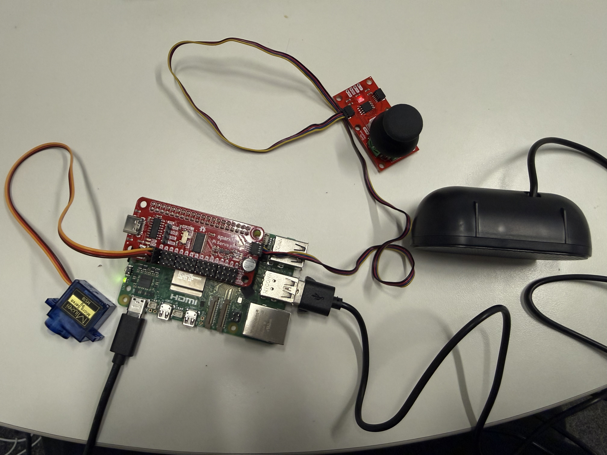
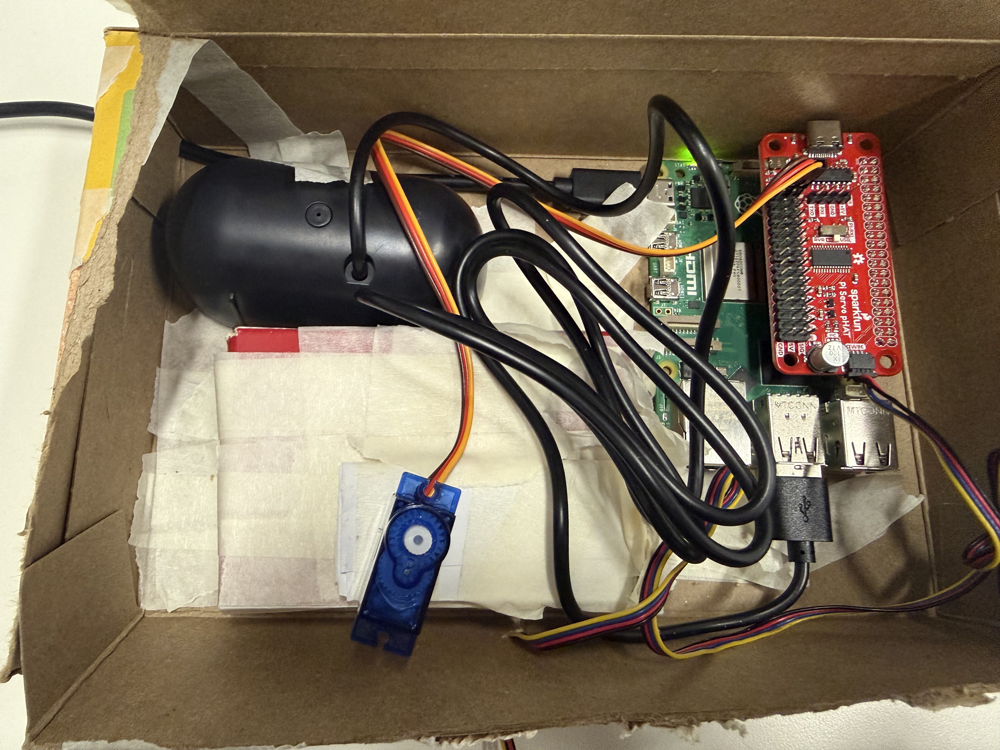
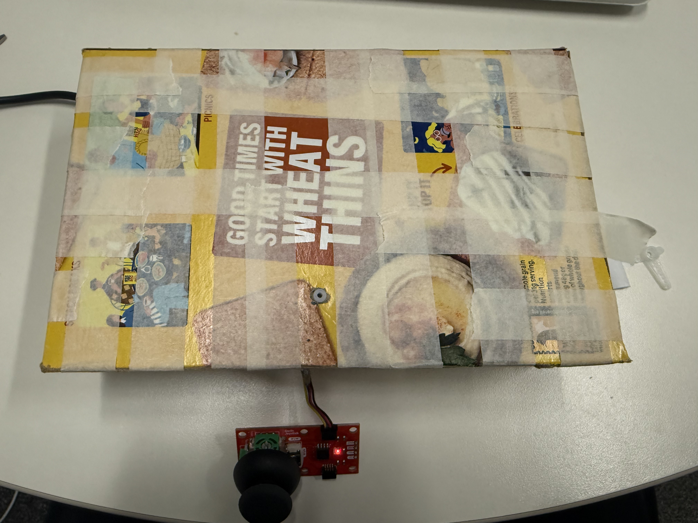
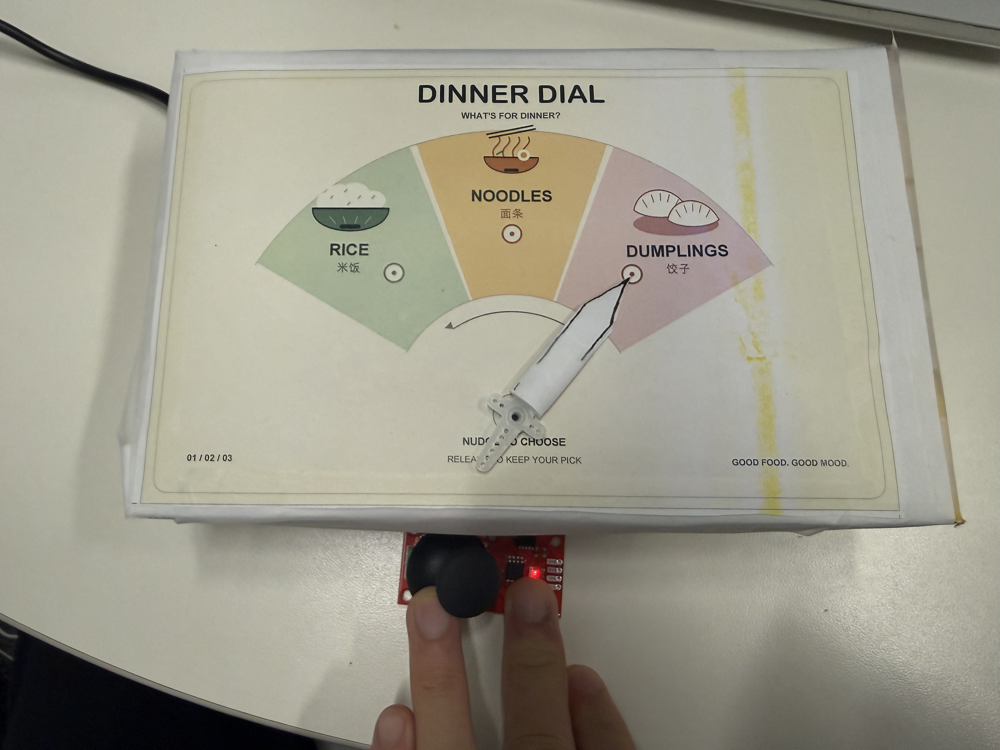

The earlier paper-prototype photos in [Part D](#part-d) document the layout exploration. The final demonstration should show the joystick, moving pointer, and spoken feedback together.

#### 3. Interaction Diagram

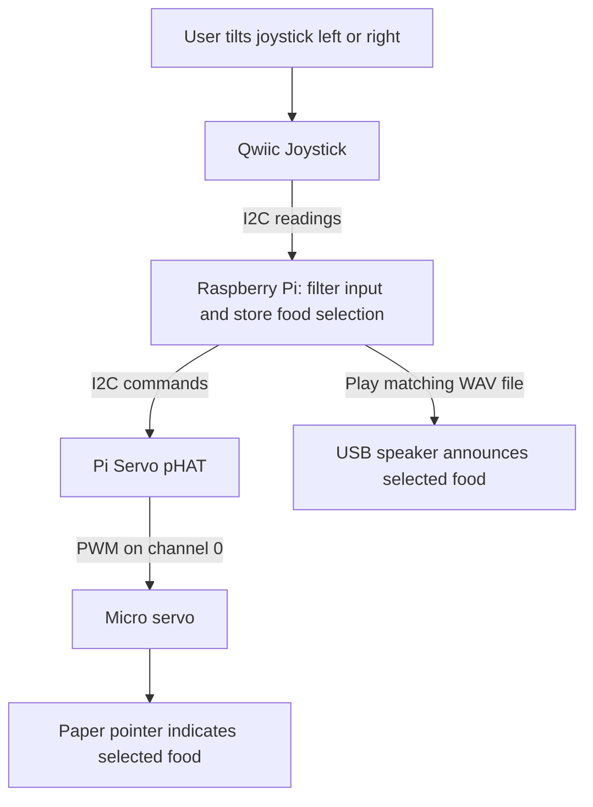

#### 4. Reflection

**What did I learn about connecting sensing, movement, and physical form?**

I learned that successful component tests do not guarantee that the assembled interaction will feel correct. The joystick could report values and the servo could move, but the pointer still needed to travel in the expected direction and line up with the printed menu. The box also made mounting and clearance important. After installation, I checked that the servo stayed stable and that the pointer did not touch the lid.

**How does the chosen input shape the physical response?**

The joystick gives the interaction a clear directional gesture: left moves toward Rice, and right moves toward Dumplings. I use its readings to choose among three positions. Tilting farther does not select a position between foods. Keeping the selected food after release lets the user make a choice without continuously holding the joystick.

**How does the physical arrangement change the interaction?**

The front-mounted joystick in the paper prototype placed the input close to the user, with the menu behind it. Keeping the menu fixed makes the pointer’s movement easy to interpret. Moving the servo into the box gave the mechanism a defined mounting position, but also required enough space above the lid for the pointer to sweep freely.

**What thresholds, timing, or movement patterns make the interaction clear or playful?**

The joystick’s measured neutral value was about 498. The program recognizes a left tilt at 338 or below and a right tilt at 658 or above. Readings from 398 to 598 count as neutral. A reading must remain in a recognized region for about 0.12 seconds before it is accepted.

These settings help separate deliberate gestures from small changes around the center. Requiring a return to neutral creates a clear “tilt, release, tilt” rhythm. The servo movement is ramped during selection changes, and the spoken food name gives another way to understand the result.

**What changes when sensor placement or servo motion is adjusted?**

In my joystick’s current orientation, the Y axis corresponds to the user’s left and right movement. Rotating the joystick would require checking the axis and direction again.

Servo orientation also changed the mapping. My installation initially moved the pointer opposite to the intended direction, so I reversed the output mapping in software. I also found that the original center command did not point at the middle of the printed menu. Adjusting the center and endpoints made the software match the assembled object.

**What was fun, surprising, or challenging?**

The playful part is that a small joystick gesture produces both a moving pointer and a spoken dinner choice. The most surprising discovery was that the physical middle of my menu did not match the original 1500 μs setting; 1200 μs worked for my installation. The main challenge was coordinating the input direction, pointer positions, and audio while testing the complete build.

#### 5. Iterations and Discoveries

| Iteration | Change | What I discovered |
|---|---|---|
| Paper layout | Built the menu, pointer, and supports from A4 paper and tape. | The rough model helped establish component placement and space for the pointer. |
| Cardboard enclosure | Mounted the printed menu on a 20 × 13 cm box and installed the servo inside. | Pointer clearance and a stable servo mount had to be checked after assembly. |
| Direction correction | Reversed the servo endpoint mapping in software. | The physical mounting direction determines which pulse values correspond to left and right. |
| Position adjustment | Set the center to 1200 μs and widened the endpoints to 1650 μs and 900 μs. | The initial movement was too narrow, and the three positions needed adjustment against the actual menu. |
| Audio integration | Added automatic English announcements on selection changes. | Movement and speech could communicate the same selection without an extra button press. |
| Power troubleshooting | Returned to the original power supply after a USB audio playback failure. | Motion and speech worked together again after the change, showing the value of testing the complete powered system. |

A next iteration would compare joystick positions at the front and side of the box, and improve the mounting and cable routing. These are future improvements; the current prototype focuses on reliable three-choice selection with physical and spoken feedback.
---

---

---

### Part F

https://github.com/user-attachments/assets/103171e7-c5bc-466f-97ff-4b11bf2d7253

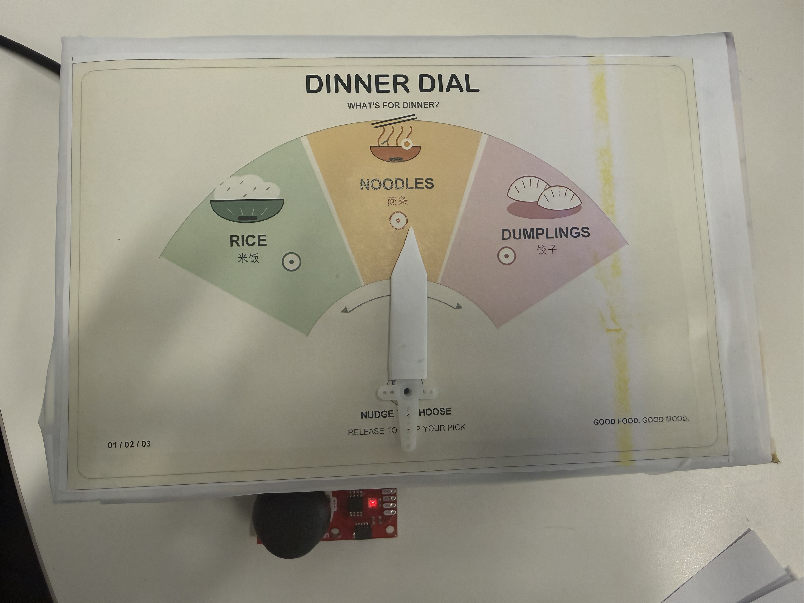
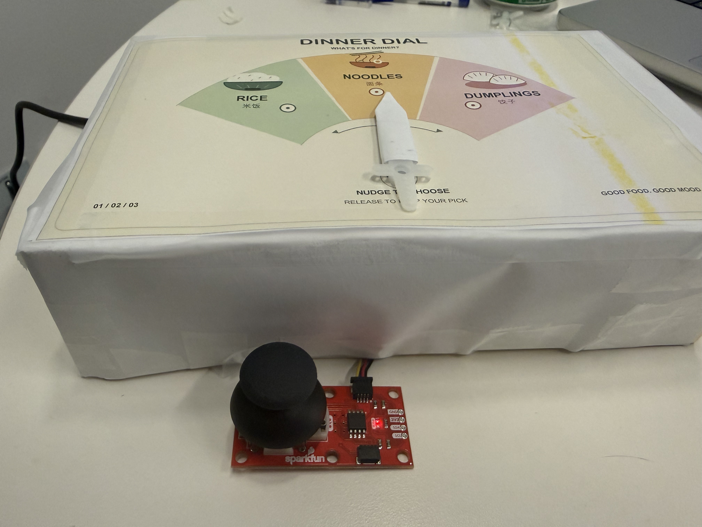
