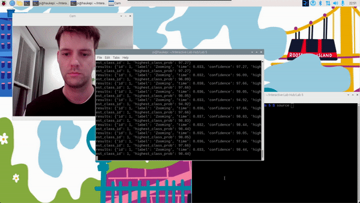
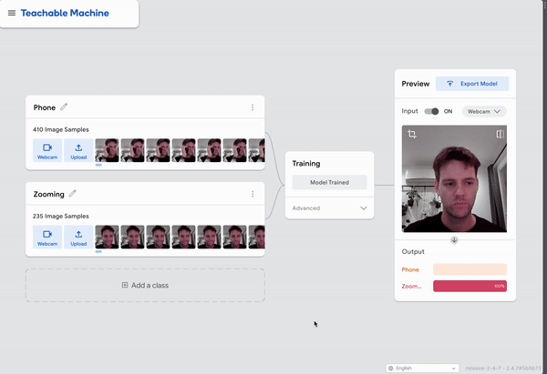

# Observant Systems: *Overnight Sensation*

**NAMES OF COLLABORATORS HERE**


For lab this week, we focus on creating interactive systems that can detect and respond to events or stimuli in the environment of the Pi, like the Boat Detector we mentioned in lecture. 
Your **observant device** could, for example, count items, find objects, recognize an event or continuously monitor a room.

This lab will help you think through the design of observant systems, particularly corner cases that the algorithms need to be aware of.

**New this year: real AI on the device.** The Pi can now run a modern object detector ([YOLO](https://docs.ultralytics.com/)) and a small language / vision-language model ([Qwen](https://ollama.com/library/qwen3.5) via [Ollama](https://ollama.com)) completely offline. They are slow compared to a laptop or the cloud, but they have *all night*. So the theme of this lab is **Overnight Sensation**: build an observant system that works while you sleep and has something to show you when you wake up. Read [the theme](#overnight-sensation) and the [toolbox](#toolbox-stuff-we-can-use) before you start playing in [Part A](#part-a).

## Prep

1.  Install VNC on your laptop if you have not yet done so. The Part A demos open a video window, so you will run them on your Pi through VNC. Please refer to the [prep for Lab 2](https://github.com/FAR-Lab/Interactive-Lab-Hub/blob/-/Lab%202/prep.md#using-vnc-to-see-your-pi-desktop). (The overnight scripts later in the lab run *headless* over plain ssh.)
2.  Install the dependencies as described in the [prep document](prep.md). Then install the two new tools, Ollama and `ultralytics`, as described in the [toolbox](#toolbox-stuff-we-can-use). Pull the models while you are on fast wifi, they are 0.5 to 2 GB each.
3.  Read about [OpenCV](https://opencv.org/about/), [Pytorch](https://pytorch.org/), [MediaPipe](https://mediapipe.dev/), [TeachableMachines](https://teachablemachine.withgoogle.com/), [Ultralytics YOLO](https://docs.ultralytics.com/guides/raspberry-pi/), and [Ollama](https://github.com/ollama/ollama/blob/main/docs/api.md).
4.  Read Belloti, et al.'s [Making Sense of Sensing Systems: Five Questions for Designers and Researchers](https://www.cc.gatech.edu/~keith/pubs/chi2002-sensing.pdf).

### For the lab, you will need:
1. Pull the new Github Repo
1. Raspberry Pi 5 (the 4 GB model is enough for the language model; 8 GB is comfortable)
1. Webcam
1. A place where the Pi can sit undisturbed for a whole night, with power, and ideally wifi
1. Optional: the sensors and the small display from the earlier labs

### Deliverables for this lab are:
1. Show pictures, videos of the "sense-making" algorithms you tried. Try at least one of the new on-device tools (YOLO or Ollama/Qwen).
1. Show a video of how you embed one of these algorithms into your observant system. Your system has **two interaction moments**: bedtime and morning. Show both.
1. Evidence from at least one real overnight run: the log it produced, the morning output, and what went wrong.
1. Test, characterize your interactive device. Show faults in the detection and how the system handled it.

## Overview
Building upon the paper-airplane metaphor (we're understanding the material of machine learning for design), here are the four sections of the lab activity:

A) [Play](#part-a)

B) [Fold](#part-b)

C) [Flight test](#part-c)

D) [Reflect](#part-d)

---

## Overnight Sensation

Real-time AI on a Pi is a struggle: a detection every few seconds, a sentence every half minute, a described image every few minutes. Instead of fighting that, this lab embraces it. **The device works through the night, and the interaction happens at two moments:**

1. **Bedtime (the hand-off).** You set the device up and tell it what to pay attention to, or what to chew on. This is where the system's *intent* is set: a mode switch, a sentence typed or spoken, a camera pointed at something, a folder dropped in, a button held. It should be a 30-second ritual, not a configuration screen. How does the device show that it understood, and that it is now on duty?
2. **Morning (the reveal).** You wake up to a result: a sentence, a number, a picture, a sound, a printout, a little animation on a display. It should be understandable before coffee, and it should be honest about what the system is unsure of.

Pick one of two flavors, or combine them:

* **Sense all night.** The Pi watches, listens or measures from bedtime until morning (camera, microphone, or the sensors from the earlier labs) and keeps a log. Examples: who or what moved through the kitchen and when; did the cat come in; how restless was the sleeper (motion in the bed); how often did the fridge door open (light sensor inside it); when did the street go quiet; what did the plant do. In the morning the log becomes a story, a timeline, a timelapse, a single headline.
* **Process all night.** You already have the data (a day of phone photos, a lecture recording, a long video, a folder of notes, a semester of chat exports) and the Pi needs hours to get through it with YOLO, the vision-language model or the LLM. Examples: caption and sort every photo from the trip; find every frame with a bicycle in a dashcam video; transcribe and summarize a recording; cluster notes into themes and name them. The morning reveal is the digest.

Either way, the interesting design questions are the ones from Bellotti et al.: how do you *address* the system at bedtime, how does it show it is paying *attention*, how will you know in the morning that it was *aligned* with what you asked, and what happens with the *accidents* (a roommate walking through, a light left on, the camera knocked over, the Pi rebooting at 3 am)?

A few constraints that make this doable in a week:

* **Sample, don't stream.** One look every 5 to 30 seconds is plenty for an overnight log. It keeps the Pi cool and the log small.
* **Log labels, not video.** Store timestamps, detected classes and counts, plus a small snapshot of the interesting moments. A night of JSON lines is a few hundred kilobytes.
* **Let the LLM write, not watch.** Use YOLO, MediaPipe or sensors for the all-night part and the language model for the morning part (summarize, name, narrate, pick). Running both at once squeezes the Pi 5 and is slow.
* **Local by design.** Everything stays on the Pi. That is the point of on-device AI, and it is what makes an overnight camera in a shared space defensible. Still: tell your roommates, point the camera at things rather than at beds, and delete the snapshots after the demo.

## Toolbox: stuff we can use

### Models that run on the Pi
Details and code for each are in [Part A](#part-a).

| need | tool | notes |
|---|---|---|
| what objects, where, how many | **YOLO26n** via `ultralytics`, exported to NCNN | 80 COCO classes, boxes and tracking IDs. Ultralytics measured ~67 ms per 640 px frame on the Pi 5; use 320 px and it is faster. |
| describe a photo, answer a question about it | **Qwen3.5 0.8B** via Ollama (`qwen3.5:0.8b`), or `moondream` | tens of seconds to minutes per image. Use on the *interesting* snapshots, never on every frame. |
| summarize, narrate, name, classify text | **Qwen3 0.6B** (`qwen3:0.6b`) or **Qwen3.5 0.8B** via Ollama | ~16 tokens/s on a Pi 5 for the 0.6B model. Turn thinking off. |
| hands, faces, body pose | **MediaPipe** (`hand_pose.py`) | fast; good for "someone sat up" style events |
| your own 2 to 5 classes | **Teachable Machine** (`tml_example.py`) | train on your laptop, run the `.tflite` on the Pi |
| a 1000-class label for the whole frame | **MobileNet** (`infer.py`) | the fastest of the lot |
| motion: the cheapest "something happened" gate | OpenCV frame differencing | see [CV_optional/cv.md](CV_optional/cv.md). Run YOLO only when this fires. |
| loudness and frequency events | `Audio_optional/ExampleAudioFFT.py` | RMS threshold, peak detection, see [Audio_optional/audio.md](Audio_optional/audio.md) |
| speech to text for "process all night" | [whisper.cpp](https://github.com/ggml-org/whisper.cpp) with the `tiny` or `base` model | hours of audio over a night is fine |

### Installing the two new tools

Ollama is a normal Linux arm64 program. Install it on the Pi, then pull a model:

```bash
curl -fsSL https://ollama.com/install.sh | sh
ollama pull qwen3.5:0.8b      # ~1.3 GB, text + images
ollama pull qwen3:0.6b        # ~0.5 GB, text only, fastest useful model
```

YOLO comes from the `ultralytics` package. Install it into the lab's virtual environment (it pulls in torch, so be patient), then export the nano model to NCNN once. NCNN is the ARM-optimized runtime that is fastest on the Pi.

```bash
(.venv) pip install ultralytics
(.venv) python -c "from ultralytics import YOLO; YOLO('yolo26n.pt').export(format='ncnn')"
```

### Hardware
* Raspberry Pi 5. The 4 GB model runs a small language model and YOLO; 8 GB is comfortable. A USB webcam. A power supply that will not be unplugged by a roommate at 2 am.
* The sensors and the Mini PiTFT display from the earlier labs. A light, temperature, distance or IMU sensor is often the better overnight observer than a camera: cheaper, no privacy issue, trivially logged.
* Optional accelerators, only if your team already has one: the [Raspberry Pi AI Camera](https://www.raspberrypi.com/documentation/accessories/ai-camera.html) runs detection on the sensor itself, and the [AI HAT+](https://www.raspberrypi.com/documentation/accessories/ai-hat-plus.html) runs YOLO at real-time frame rates. Not required.
* Cooling. A Pi running inference for eight hours gets hot and throttles. Use the heatsink or fan if you have one, and sample instead of streaming.

### Running unattended (the part that usually breaks)
* **Headless.** The overnight script must not call `cv2.imshow`. Then it runs fine over ssh without VNC. Write to a log file instead of the screen.
* **Survive the ssh disconnect.** Start the script inside `tmux` (`tmux new -s night`, detach with Ctrl-B then D, come back with `tmux attach -t night`), or with `nohup python overnight.py > night.out 2>&1 &`.
* **Schedule it, or make starting it the ritual.** `cron` is enough:

  ```
  # crontab -e
  0 23 * * *  cd ~/Interactive-Lab-Hub/Lab\ 5 && .venv/bin/python overnight.py >> night.out 2>&1
  0 7  * * *  pkill -f overnight.py; cd ~/Interactive-Lab-Hub/Lab\ 5 && .venv/bin/python morning.py > report.txt
  ```

  Or start it by hand at bedtime. That *is* the bedtime interaction, so design it.
* **Time.** The Pi has no battery-backed clock. Check `date` before you trust your timestamps; NTP needs wifi.
* **Fail soft.** Wrap the camera read and the model call in `try/except`, sleep, and continue. A night that crashed at 1 am and a quiet night look identical in the morning unless you also log heartbeats, so write an "alive" line every 10 minutes.

### Logging
* One JSON object per line (`night_log.jsonl`) with an ISO timestamp is the easiest thing to write at night and read in the morning. Use `sqlite3` if you want to query.
* Save a small JPEG only for interesting moments: the first detection of a new class, a motion spike, the busiest minute. A whole night of 640×480 JPEGs every 10 seconds is roughly 150 MB. The SD card can take it, but you will never look at them.

### Morning outputs (lightweight visualization or presentation)
* **A sentence.** The LLM turns the log into a three-sentence report. Read it aloud with `espeak-ng` (`sudo apt install espeak-ng`) or [Piper](https://github.com/rhasspy/piper) for a nicer voice, show it on the Mini PiTFT, or print it on a receipt printer if you have one.
* **A timeline.** A `matplotlib` histogram of events per hour, saved as a PNG, shown on the display or sent to your phone.
* **A timelapse or contact sheet.** `ffmpeg -framerate 12 -pattern_type glob -i 'snaps/*.jpg' night.mp4`, or a grid of the twelve most interesting snapshots made with PIL.
* **A page on your phone.** A twenty-line Flask app serving `report.txt` and the PNG at `http://<pi-ip>:5000`.
* **A structured morning.** Ask the model for JSON (the `format` parameter) with fields such as `headline`, `busiest_hour`, `surprise`, and render each field differently: an LED, a display line, a sound.

### Worked example: a camera night watch in two scripts
This is the minimum viable overnight system. Steal it, then make it yours.

Night (runs for hours, headless, YOLO only):

```python
# overnight.py: log what the camera sees all night
import cv2, json, time, datetime, pathlib
from ultralytics import YOLO

model = YOLO("yolo26n_ncnn_model")            # exported once, see above
cap = cv2.VideoCapture(0)
cap.set(cv2.CAP_PROP_FRAME_WIDTH, 640)
cap.set(cv2.CAP_PROP_FRAME_HEIGHT, 480)
pathlib.Path("snaps").mkdir(exist_ok=True)
log = open("night_log.jsonl", "a")

while True:
    try:
        ok, frame = cap.read()
        if not ok:
            raise RuntimeError("no frame")
        r = model.predict(frame, imgsz=320, conf=0.4, verbose=False)[0]
        names = [model.names[int(c)] for c in r.boxes.cls]
        ts = datetime.datetime.now().isoformat(timespec="seconds")
        log.write(json.dumps({"t": ts, "objects": names}) + "\n")
        log.flush()
        if names:
            cv2.imwrite(f"snaps/{ts}.jpg", frame)   # a snapshot only when something is there
    except Exception as e:
        print("hiccup:", e, flush=True)
    time.sleep(10)                               # one look every 10 s, ~3000 looks per night
```

Morning (runs once, LLM only):

```python
# morning.py: turn the night log into a short report
import json, collections, requests

events = [json.loads(l) for l in open("night_log.jsonl")]
seen = [e for e in events if e["objects"]]
counts = collections.Counter(o for e in seen for o in e["objects"])
digest = "\n".join(f'{e["t"]}: {", ".join(e["objects"])}' for e in seen[-300:])  # keep the prompt small

prompt = f"""You are a bedside night-watch device. Below is what the camera saw overnight,
one line per observation (time: objects). Totals for the night: {dict(counts)}.

{digest}

Write a warm three-sentence morning report. Mention the most unusual moment and when it happened.
Only use facts from the log. If the night was quiet, say so."""

r = requests.post("http://localhost:11434/api/generate", json={
    "model": "qwen3.5:0.8b",
    "prompt": prompt,
    "think": False,                 # skip the reasoning trace; it doubles the wait on a Pi
    "stream": False,
    "options": {"num_ctx": 4096, "temperature": 0.3},
}, timeout=600)
print(r.json()["response"])
```

Things to try from here: gate the YOLO call behind cheap motion detection so the Pi idles on quiet nights; use `model.track()` so you can count *different* people rather than frames with a person; send the three most interesting snapshots to `qwen3.5:0.8b` with the `images` parameter and let it describe them; ask for JSON instead of prose and drive a display with it; replace the camera with a sensor.

---

### Part A
### Play with different sense-making algorithms.

#### Pytorch for object recognition

For this first demo, you will be using PyTorch and running a MobileNet v2 classification model in real time (30 fps+) on the CPU. We will be following steps adapted from [this tutorial](https://pytorch.org/tutorials/intermediate/realtime_rpi.html).


To get started, install dependencies into a virtual environment for this exercise as described in [prep.md](prep.md).

Make sure your webcam is connected.

You can check the installation by running:

```
python -c "import torch; print(torch.__version__)"
```

If everything is ok, you should be able to start doing object recognition. For this default example, we use [MobileNet_v2](https://arxiv.org/abs/1801.04381). This model is able to perform object recognition for 1000 object classes (check [classes.json](classes.json) to see which ones.

Start detection by running  

```
python infer.py
```

The first 2 inferences will be slower. Now, you can try placing several objects in front of the camera.

Read the `infer.py` script and become familiar with the code. You can change the video resolution and frames per second (FPS). You may also use the weights of the larger pre-trained mobilenet_v3_large model, as described [here](https://pytorch.org/tutorials/intermediate/realtime_rpi.html#model-choices).

#### More classes

[PyTorch supports transfer learning](https://pytorch.org/tutorials/beginner/transfer_learning_tutorial.html), so you can fine‑tune and transfer learn models to recognize your own objects. It requires extra steps, so we won't cover it here.

For more details on transfer learning and deployment to embedded devices, see Deep Learning on Embedded Systems: A Hands‑On Approach Using Jetson Nano and Raspberry Pi (Tariq M. Arif). [Chapter 10](https://onlinelibrary.wiley.com/doi/10.1002/9781394269297.ch10) covers transfer learning for object detection on desktop, and [Chapter 15](https://onlinelibrary.wiley.com/doi/10.1002/9781394269297.ch15) describes moving models to the Pi using ONNX.

#### YOLO for object detection (where, and how many)

MobileNet tells you *what* is in the frame. [YOLO](https://docs.ultralytics.com/) also tells you *where* and *how many*: it draws a box around every person, cup, cat, bicycle and so on (the 80 [COCO](https://cocodataset.org/) classes) and can track them from frame to frame. The current generation is [YOLO26](https://docs.ultralytics.com/models/yolo26/), released in January 2026 and designed for edge devices like the Pi. The nano model, `yolo26n`, is the one to use here; Ultralytics keeps an up-to-date [Raspberry Pi guide](https://docs.ultralytics.com/guides/raspberry-pi/) with benchmarks.

Install `ultralytics` and export the model to NCNN as described in the [toolbox](#installing-the-two-new-tools). Then run it on your webcam (through VNC, because of the window):

```python
import cv2
from ultralytics import YOLO

model = YOLO("yolo26n_ncnn_model")
cap = cv2.VideoCapture(0)

while True:
    ok, frame = cap.read()
    if not ok:
        break
    results = model.predict(frame, imgsz=320, conf=0.4, verbose=False)
    names = [model.names[int(c)] for c in results[0].boxes.cls]
    print(names)                                  # e.g. ['person', 'cup', 'cup']
    cv2.imshow("YOLO", results[0].plot())         # remove this line when running headless
    if cv2.waitKey(1) == ord("q"):
        break
```

Things to look at: `results[0].boxes.xyxy` gives you the box corners, so you can tell *where* something was (left or right of the desk, inside a region you define). `model.track(frame, persist=True)` gives every object a persistent ID, which you need to count *different* people instead of frames containing a person. Lower `conf` to see what the model is unsure about. The Ultralytics guide uses the Pi Camera through `picamera2`; our USB webcams work with `cv2.VideoCapture(0)` just like the other scripts in this folder.

Speed: Ultralytics measured about 67 ms per 640 px frame for YOLO26n in NCNN format on a Pi 5. At 320 px it is roughly two to three times faster. For an overnight system you rarely need more than one frame every few seconds anyway.

### Machine Vision With Other Tools
The following sections describe tools ([MediaPipe](#mediapipe) and [Teachable Machines](#teachable-machines)).

#### MediaPipe

A established open source and efficient method of extracting information from video streams comes out of Google's [MediaPipe](https://mediapipe.dev/), which offers state of the art face, face mesh, hand pose, and body pose detection.


To get started, install dependencies into a virtual environment for this exercise as described in [prep.md](prep.md):

Each of the installs will take a while, please be patient. After successfully installing mediapipe, connect your webcam to your Pi and use **VNC to access to your Pi**, open the terminal, and go to Lab 5 folder and run the hand pose detection script we provide:
(***it will not work if you use ssh from your laptop***)


```
(venv-ml) pi@ixe00:~ $ cd Interactive-Lab-Hub/Lab\ 5
(venv-ml) pi@ixe00:~ Interactive-Lab-Hub/Lab 5 $ python hand_pose.py
```

Try the two main features of this script: 1) pinching for percentage control, and 2) "[Quiet Coyote](https://www.youtube.com/watch?v=qsKlNVpY7zg)" for instant percentage setting. Notice how this example uses hardcoded positions and relates those positions with a desired set of events, in `hand_pose.py`. 

Consider how you might use this position based approach to create an interaction, and write how you might use it on either face, hand or body pose tracking.

(You might also consider how this notion of percentage control with hand tracking might be used in some of the physical UI you may have experimented with in the last lab, for instance in controlling a servo or rotary encoder.)

### Language and vision-language models with Ollama

#### Ollama and Qwen: a language model on the Pi

[Ollama](https://ollama.com) runs open language models locally and serves them on `http://localhost:11434`. Nothing leaves the Pi: no API key, no internet after the download. Install it and pull a model as described in the [toolbox](#installing-the-two-new-tools). These are the models that make sense on a Pi:

| model | download | what it does | speed on the Pi |
|---|---|---|---|
| `qwen3.5:0.8b` | ~1.3 GB | text **and images** (it is a vision-language model), tool calls, optional thinking | text: a few tokens per second on a Pi 5; an image question: tens of seconds and up |
| `qwen3:0.6b` | ~0.5 GB | text only, very small | ~16 tokens/s on a Pi 5 ([Adafruit measured it](https://learn.adafruit.com/local-llms-on-raspberry-pi/qwen3)) |
| `qwen2.5:0.5b` | ~0.4 GB | text only, older and lightest | fastest, least capable |
| `moondream` | ~1.7 GB | image description only, see below | minutes per image |

Larger models (2B, 4B) run on an 8 GB Pi 5 but are slow enough that you will only want them for the "process all night" flavor.

Talk to the model in the terminal first:

```bash
ollama run qwen3.5:0.8b
>>> /set nothink          # skip the reasoning trace, it doubles the wait on a Pi
>>> Give me three names for a device that watches a kitchen overnight.
>>> /bye
```

From Python, talk to it exactly like `moondream_simple.py` does, with plain HTTP and no SDK:

```python
import requests

r = requests.post("http://localhost:11434/api/generate", json={
    "model": "qwen3.5:0.8b",
    "prompt": "In one sentence: what is a good name for a device that watches a room overnight?",
    "think": False,
    "stream": False,
}, timeout=600)
print(r.json()["response"])
```

Four parameters of the [Ollama API](https://github.com/ollama/ollama/blob/main/docs/api.md) matter for overnight work:

* `"think": False` turns off the reasoning trace that Qwen3 models produce by default. Always set it on the Pi unless you are curious.
* `"images": ["<base64 jpeg>"]` sends a photo along with the prompt. That is all `moondream_simple.py` does; change its model name to `qwen3.5:0.8b` and it works with the newer model.
* `"format": {<json schema>}` forces the answer into a JSON object with the fields you name, so you can plot or display it instead of parsing prose. Example: `{"type": "object", "properties": {"headline": {"type": "string"}, "busiest_hour": {"type": "string"}, "surprise": {"type": "string"}}, "required": ["headline", "busiest_hour", "surprise"]}`.
* `"keep_alive"` controls how long the model stays in RAM after a request (default five minutes). Use `0` to free memory for YOLO, or `-1` to keep it loaded during a batch job.

**Design consideration**: a 0.8B model is slow and sometimes wrong. It will happily invent an event that is not in your log. Give it the data in the prompt, ask for short outputs, and keep its job narrow (summarize, label, pick, name) rather than open-ended. Decide what the morning output should look like when the model is unsure, and test the prompt on an empty log and on a log full of noise.

#### Moondream Vision-Language Model

[Moondream](https://www.ollama.com/library/moondream) is a lightweight vision-language model that can understand and answer questions about images. Unlike the classification models above, Moondream can describe images in natural language and answer specific questions about what it sees. (`qwen3.5:0.8b` above does the same job with a newer model; try both and compare.)

To use Moondream, first make sure Ollama is running and pull the model:
```bash
ollama pull moondream
```

Then run the simple demo script:
```bash
python moondream_simple.py
```

This will capture an image from your webcam and let you ask questions about it in natural language. Note that vision-language models are slower than classification models (responses may take up to minutes on a Raspberry Pi). There are newer models like [LFM2-VL](https://huggingface.co/LiquidAI/LFM2-VL-450M-GGUF), but many are very recent and not yet optimized for embedded devices.

**Design consideration**: Think about how slower response times change your interaction design. What kinds of observant systems benefit from thoughtful, delayed responses rather than real-time classification? Consider systems that monitor over longer time periods or provide periodic summaries rather than instant feedback. This is exactly the bet behind [Overnight Sensation](#overnight-sensation).

#### Teachable Machines
Google's [TeachableMachines](https://teachablemachine.withgoogle.com/train) is very useful for prototyping with the capabilities of machine learning. We are using [a python package](https://github.com/MeqdadDev/teachable-machine-lite) with tensorflow lite to simplify the deployment process.



To get started, install dependencies into a virtual environment for this exercise as described in [prep.md](prep.md):

After installation, connect your webcam to your Pi and use **VNC to access to your Pi**, open the terminal, and go to Lab 5 folder and run the example script:
(***it will not work if you use ssh from your laptop***)


```
(venv-tml) pi@ixe00:~ Interactive-Lab-Hub/Lab 5 $ python tml_example.py
```


Next train your own model. Visit [TeachableMachines](https://teachablemachine.withgoogle.com/train), select Image Project and Standard model. The Raspberry Pi 5 is capable to run not just the low resource models. Second, use the webcam on your computer to train a model. *Note: It might be advisable to use the pi webcam in a similar setting you want to deploy it to improve performance.*  For each class try to have over 150 samples, and consider adding a background or default class where you have nothing in view so the model is trained to know that this is the background. Then create classes based on what you want the model to classify. Lastly, preview and iterate. Finally export your model as a 'Tensorflow lite' model. You will find an '.tflite' file and a 'labels.txt' file. Upload these to your pi (through one of the many ways such as [scp](https://www.raspberrypi.com/documentation/computers/remote-access.html#using-secure-copy), sftp, [vnc](https://help.realvnc.com/hc/en-us/articles/360002249917-VNC-Connect-and-Raspberry-Pi#transferring-files-to-and-from-your-raspberry-pi-0-6), or a connected visual studio code remote explorer).



Include screenshots of your use of Teachable Machines, and write how you might use this to create your own classifier. Include what different affordances this method brings, compared to the OpenCV or MediaPipe options.

#### (Optional) Legacy audio and computer vision observation approaches
In an earlier version of this class students experimented with observing through audio cues. Find the material here:
[Audio_optional/audio.md](Audio_optional/audio.md). 
Teachable machines provides an audio classifier too. If you want to use audio classification this is our suggested method. For an overnight system, the simple RMS loudness and peak detection in that material is a very good, very cheap sensor.

In an earlier version of this class students experimented with foundational computer vision techniques such as face and flow detection. Techniques like these can be sufficient, more performant, and allow non discrete classification. Find the material here:
[CV_optional/cv.md](CV_optional/cv.md). Frame differencing and optical flow are ideal "is anything happening" gates in front of a slow model.

### Part B
### Construct a simple interaction.

* Pick one of the models you have tried, and experiment with prototyping an interaction.
* This can be as simple as the boat detector shown in lecture, stretched over a night.
* Design **both moments** of the Overnight Sensation:
  * **Bedtime.** How does someone tell the device what to watch or what to process? How does the device acknowledge it? How does it show it is still working at 2 am without lighting up the room?
  * **Morning.** What is the one thing the person should learn? In what medium (voice, display, print, light, sound, a page on the phone)? How does the output communicate uncertainty or a boring night?
* Try out different interaction outputs and inputs. Pick the sensing model for its all-night cost, and the language model for the morning.
* Before the real overnight run, do a "ten-minute night": run the night script for ten minutes while you walk around, then run the morning script. Iterate on the prompt and the output until the ten-minute version feels right.


**\*\*\*Describe and detail the interaction, as well as your experimentation here.\*\*\***

### Part C
### Test the interaction prototype

Now flight test your interactive prototype and **note down your observations**. Run it for at least one real night.
For example:
1. When does it what it is supposed to do?
1. When does it fail?
1. When it fails, why does it fail?
1. Based on the behavior you have seen, what other scenarios could cause problems?

Overnight-specific things to look for:
1. What did the detector see in the dark, at dawn, under a streetlight, when a car's headlights swept the room? Night is a different environment than the one you tested in.
1. What did the language model say about a night with no events? About a night with a thousand near-identical events? Did it invent anything?
1. Did the script survive the whole night? (Check the heartbeats.) Did the Pi get hot, run out of disk, or lose the time?
1. Who else was observed, and did they know?

**\*\*\*Think about someone using the system. Describe how you think this will work.\*\*\***
1. Are they aware of the uncertainties in the system?
1. How bad would they be impacted by a miss classification?
1. How could change your interactive system to address this?
1. Are there optimizations you can try to do on your sense-making algorithm.

### Part D
### Characterize your own Observant system

Now that you have experimented with one or more of these sense-making systems **characterize their behavior**.
During the lecture, we mentioned questions to help characterize a material:
* What can you use X for?
* What is a good environment for X?
* What is a bad environment for X?
* When will X break?
* When it breaks how will X break?
* What are other properties/behaviors of X?
* How does X feel?

Characterize both materials you combined: the fast, narrow sensing model (YOLO, MediaPipe, a sensor) and the slow, broad language model. They break differently.

**\*\*\*Include a short video demonstrating the answers to these questions.\*\*\***

### Part 2.

Following exploration and reflection from Part 1, finish building your interactive system, and demonstrate it in use with a video: the bedtime hand-off, a time-lapse or log of the night, and the morning reveal from a real overnight run.

**\*\*\*Include a short video demonstrating the finished result.\*\*\***
