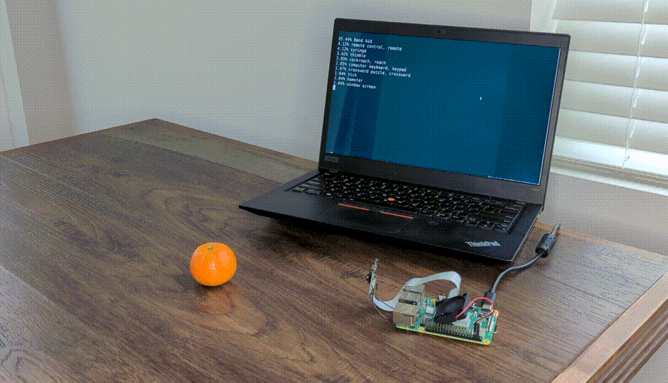
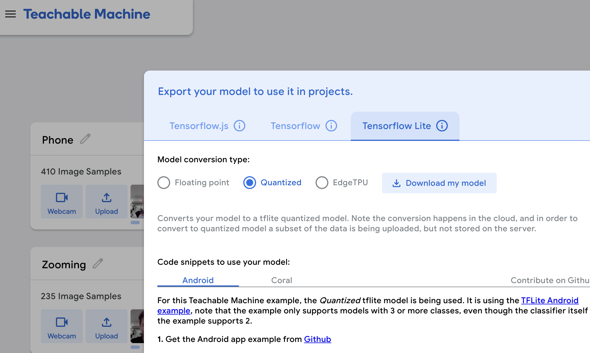

# Legacy sense-making tools

> **Note:** Everything in this folder is from earlier versions of Lab 5 and is **optional**. These tools were replaced in the main lab by YOLO (object detection) and Qwen through Ollama (language and vision-language), but the code still runs on the Pi 5 and may be exactly the sensor your night-time interaction needs. The Pi deployment packages for some of them (TensorFlow Lite in particular) are no longer maintained, so expect to do some fixing if you use them.
>
> Install their dependencies into the Lab 5 virtual environment with `pip install -r legacy/requirements.txt`, and run the scripts from inside this folder. The windowed demos need VNC, not a plain ssh session.

| tool | script | what it does | status |
|---|---|---|---|
| MobileNet v2 (PyTorch) | `infer.py` | one label per frame from 1000 ImageNet classes, 30 fps on the CPU | works; superseded by YOLO, which also localizes and counts |
| Moondream | `moondream_simple.py` | describe a webcam photo in natural language | works; the Ollama build is moondream2 from 2024. `qwen3.5:0.8b` does the same job and is newer |
| Teachable Machine | `tml_example.py`, `model.tflite`, `labels.txt` | run a classifier you trained in the browser | the web tool is current; the Pi package depends on `tflite-runtime`, unmaintained since 2023 |
| Audio FFT and thresholds | `Audio_optional/` | loudness, peaks and frequency content from a microphone | works; a very cheap overnight sensor |
| Classic OpenCV | `CV_optional/` | contours, Haar-cascade faces, optical flow, SSD object detection | works; frame differencing and flow make good "is anything happening" gates |

`converted_tflite_quantized/` is a leftover export from an earlier Teachable Machine model and can be ignored.

## Pytorch for object recognition

For this demo, you will be using PyTorch and running a MobileNet v2 classification model in real time (30 fps+) on the CPU. We will be following steps adapted from [this tutorial](https://pytorch.org/tutorials/intermediate/realtime_rpi.html).



Make sure your webcam is connected.

You can check the installation by running:

```
python -c "import torch; print(torch.__version__)"
```

If everything is ok, you should be able to start doing object recognition. For this default example, we use [MobileNet_v2](https://arxiv.org/abs/1801.04381). This model is able to perform object recognition for 1000 object classes (check [classes.json](classes.json) to see which ones).

Start detection by running  

```
(.venv) pi@raspberrypi:~/Interactive-Lab-Hub/Lab 5/legacy $ python infer.py
```

The first 2 inferences will be slower. Now, you can try placing several objects in front of the camera.

Read the `infer.py` script and become familiar with the code. You can change the video resolution and frames per second (FPS). You may also use the weights of the larger pre-trained mobilenet_v3_large model, as described [here](https://pytorch.org/tutorials/intermediate/realtime_rpi.html#model-choices).

### More classes

[PyTorch supports transfer learning](https://pytorch.org/tutorials/beginner/transfer_learning_tutorial.html), so you can fine‑tune and transfer learn models to recognize your own objects. It requires extra steps, so we won't cover it here.

For more details on transfer learning and deployment to embedded devices, see Deep Learning on Embedded Systems: A Hands‑On Approach Using Jetson Nano and Raspberry Pi (Tariq M. Arif). [Chapter 10](https://onlinelibrary.wiley.com/doi/10.1002/9781394269297.ch10) covers transfer learning for object detection on desktop, and [Chapter 15](https://onlinelibrary.wiley.com/doi/10.1002/9781394269297.ch15) describes moving models to the Pi using ONNX.

## Moondream Vision-Language Model

[Moondream](https://www.ollama.com/library/moondream) is a lightweight vision-language model that can understand and answer questions about images. Unlike the classification models above, Moondream can describe images in natural language and answer specific questions about what it sees. `qwen3.5:0.8b`, which you install in Part A of the lab, does the same job with a newer model; change the model name in `moondream_simple.py` and the script works with it.

To use Moondream, first make sure Ollama is running and pull the model:
```bash
ollama pull moondream
```

Then run the simple demo script:
```bash
(.venv) pi@raspberrypi:~/Interactive-Lab-Hub/Lab 5/legacy $ python moondream_simple.py
```

This will capture an image from your webcam and let you ask questions about it in natural language. Note that vision-language models are slower than classification models (responses may take up to minutes on a Raspberry Pi). There are newer models like [LFM2-VL](https://huggingface.co/LiquidAI/LFM2-VL-450M-GGUF), but many are very recent and not yet optimized for embedded devices.

**Design consideration**: Think about how slower response times change your interaction design. What kinds of observant systems benefit from thoughtful, delayed responses rather than real-time classification? Consider systems that monitor over longer time periods or provide periodic summaries rather than instant feedback.

## Teachable Machines

Google's [TeachableMachines](https://teachablemachine.withgoogle.com/train) is very useful for prototyping with the capabilities of machine learning. We are using [a python package](https://github.com/MeqdadDev/teachable-machine-lite) with tensorflow lite to simplify the deployment process.


Connect your webcam to your Pi and use **VNC to access to your Pi**, open the terminal, and go to this folder and run the example script:
(***it will not work if you use ssh from your laptop***)

```
(.venv) pi@raspberrypi:~/Interactive-Lab-Hub/Lab 5/legacy $ python tml_example.py
```

Next train your own model. Visit [TeachableMachines](https://teachablemachine.withgoogle.com/train), select Image Project and Standard model. The Raspberry Pi 5 is capable to run not just the low resource models. Second, use the webcam on your computer to train a model. *Note: It might be advisable to use the pi webcam in a similar setting you want to deploy it to improve performance.*  For each class try to have over 150 samples, and consider adding a background or default class where you have nothing in view so the model is trained to know that this is the background. Then create classes based on what you want the model to classify. Lastly, preview and iterate. Finally export your model as a 'Tensorflow lite' model. You will find an '.tflite' file and a 'labels.txt' file. Upload these to your pi (through one of the many ways such as [scp](https://www.raspberrypi.com/documentation/computers/remote-access.html#using-secure-copy), sftp, [vnc](https://help.realvnc.com/hc/en-us/articles/360002249917-VNC-Connect-and-Raspberry-Pi#transferring-files-to-and-from-your-raspberry-pi-0-6), or a connected visual studio code remote explorer).



Teachable Machine is a quick way to make a classifier for *your* night: "lights on / lights off", "door open / door closed", "cat on the couch / no cat".

## Legacy audio and computer vision observation approaches

In an earlier version of this class students experimented with observing through audio cues. Find the material here:
[Audio_optional/audio.md](Audio_optional/audio.md). 
Teachable machines provides an audio classifier too. If you want to use audio classification this is our suggested method. For an overnight system, the simple RMS loudness and peak detection in that material is a very good, very cheap sensor.

In an earlier version of this class students experimented with foundational computer vision techniques such as face and flow detection. Techniques like these can be sufficient, more performant, and allow non discrete classification. Find the material here:
[CV_optional/cv.md](CV_optional/cv.md). Frame differencing and optical flow are ideal "is anything happening" gates in front of a slow model.
